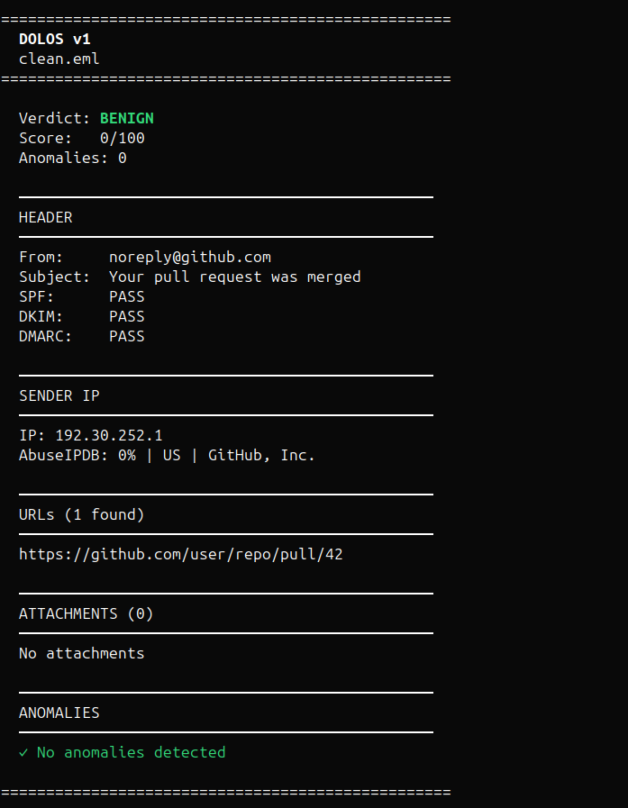
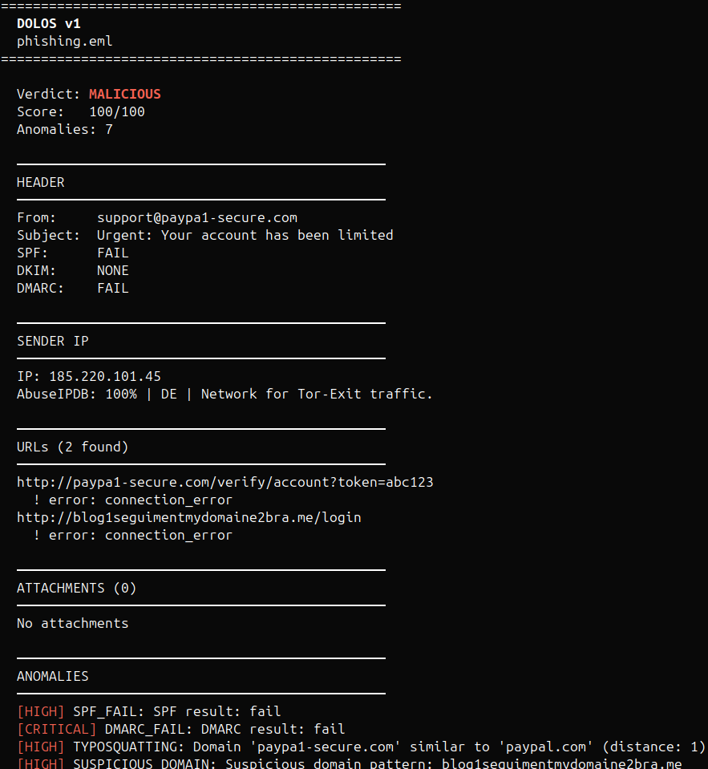
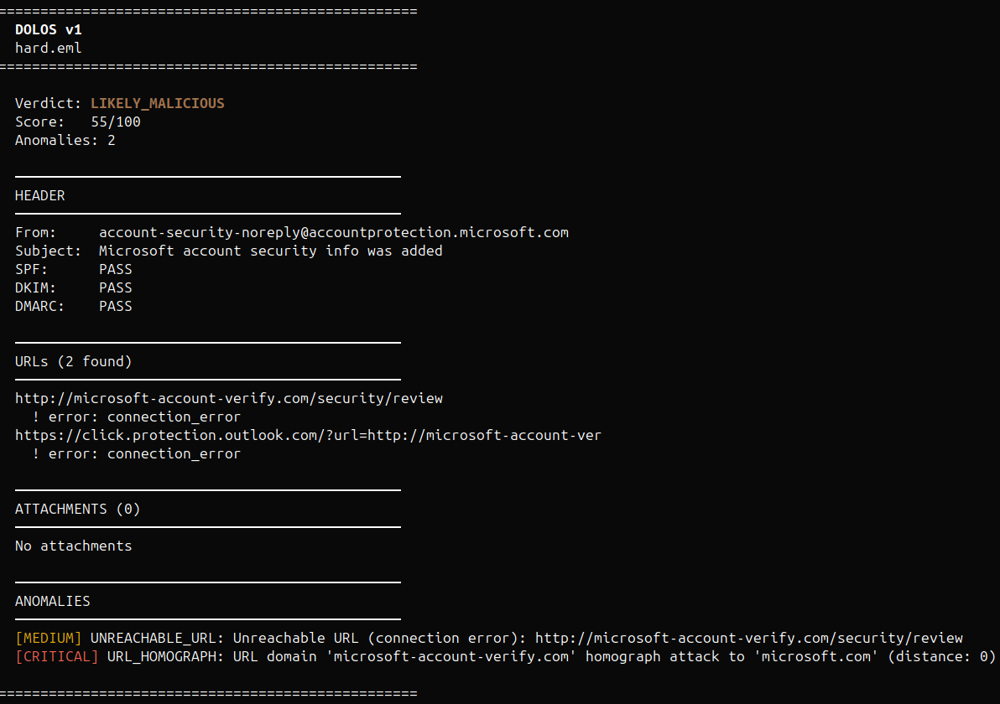

# Dolos

Analysis tool for phishing email detection. Parses `.eml` files and runs multiple detection modules to produce a scored verdict with an HTML or JSON report.

---

## How it works

```
.eml file
    │
    ├─► Header Analyzer   — SPF/DKIM/DMARC, typosquatting, homograph, Reply-To
    ├─► Body Analyzer     — URL extraction, redirect chains, keyword scoring
    ├─► Attachment Analyzer — MIME, macros, PDF analysis
    │
    ├─► Enrichment (optional) — VirusTotal · AbuseIPDB · URLhaus
    │
    └─► Scorer → verdict + HTML / JSON report
```

Each analyzer produces a list of anomalies with associated weights. The scorer aggregates them into a 0–100 score and maps it to a verdict level. Weights are configurable via `config/weights.yaml` without modifying source code.

---

## Features

### Header Analysis
- [SPF](https://datatracker.ietf.org/doc/html/rfc7208) / [DKIM](https://datatracker.ietf.org/doc/html/rfc6376) / [DMARC](https://datatracker.ietf.org/doc/html/rfc7489) result parsing
- Typosquatting detection via [Levenshtein distance](https://en.wikipedia.org/wiki/Levenshtein_distance) with deceptive suffix stripping (`-secure`, `-login`, `-notifications`, etc.)
- [Homograph attack](https://en.wikipedia.org/wiki/IDN_homograph_attack) detection — Cyrillic lookalike characters (e.g. `а`, `о`, `і`) mapped to their Latin equivalents before brand comparison
- Reply-To lookalike detection — flags when Reply-To domain is a typosquatted variant of the sender domain
- Received chain parsing with private IP filtering ([RFC 1918](https://datatracker.ietf.org/doc/html/rfc1918))

### Body Analysis
- URL extraction from plain text and HTML, including obfuscated and hidden tags
- URL extraction from query parameters (`?url=`, `?redirect=`, `?next=`)
- Redirect chain following
- URL shortener detection
- Homograph and typosquatting detection on URL domains
- Suspicious domain pattern detection (mixed digits, unusual TLDs)
- Phishing keyword scoring — urgency, credential harvesting, extortion patterns

### Attachment Analysis
- MD5 / SHA-256 hashing
- Real MIME type detection via magic bytes ([python-magic](https://github.com/ahupp/python-magic))
- Double extension detection (`invoice.pdf.exe`)
- High-risk extension flagging
- MIME type vs declared extension mismatch
- VBA macro detection in Office files ([oletools](https://github.com/decalage2/oletools))
- PDF analysis: JavaScript / OpenAction detection, embedded URL extraction ([pdfminer.six](https://github.com/pdfminer/pdfminer.six))

### Enrichment _(requires API keys)_
| Service | Lookup |
|---------|--------|
| [VirusTotal](https://developers.virustotal.com/reference/overview) | URL and file hash reputation |
| [AbuseIPDB](https://www.abuseipdb.com/api) | Sender IP reputation and abuse score |
| [URLhaus](https://urlhaus-api.abuse.ch/) | Sender IP blacklist check |

### Scoring

Anomaly weights are defined in `config/weights.yaml` and aggregated into a 0–100 score:

| Score | Verdict |
|-------|---------|
| 0 | `BENIGN` |
| 1–29 | `SUSPICIOUS` |
| 30–59 | `LIKELY_MALICIOUS` |
| ≥60 | `MALICIOUS` |

### Output
| Format | Description |
|--------|-------------|
| CLI | Colored terminal output with per-check detail |
| HTML | Full report with score bar, VirusTotal results, PDF and attachment details |
| JSON | Structured output for SIEM/SOAR integration |

---

## Installation

```bash
git clone https://github.com/sudoMic/dolos.git
cd dolos
python3 -m venv venv
source venv/bin/activate
pip install -r requirements.txt
```

### API Keys _(optional — enrichment only)_

Create a `.env` file in the project root:

```env
VIRUSTOTAL_API_KEY=your_key_here
ABUSEIPDB_API_KEY=your_key_here
```

---

## Usage

ATTENTION: the body analyzer performs live HTTP requests to follow redirects: run Dolos in an isolated environment when analyzing real samples.

```bash
# Analyze a single file (CLI output)
python3 main.py email.eml

# Full HTML report
python3 main.py email.eml --output html --save report.html

# JSON output for pipeline integration
python3 main.py email.eml --output json

# Skip external API calls
python3 main.py email.eml --no-enrichment

# Debug mode
python3 main.py email.eml --debug
```

---

## Detection Examples

### Legitimate email — `BENIGN` · Score: 0/100

Standard notification from GitHub. SPF/DKIM/DMARC all pass, clean sender IP (GitHub, Inc.), no suspicious URLs or keywords.



---

### Phishing email — `MALICIOUS` · Score: 100/100

Sender domain `paypa1-secure.com` is flagged as typosquatting of `paypal.com` (Levenshtein distance 1 after stripping the `-secure` suffix). SPF and DMARC both fail. Sender IP is a known Tor exit node ([AbuseIPDB](https://www.abuseipdb.com/) confidence 100%).



---

### Evasion attempt — `LIKELY_MALICIOUS` · Score: 55/100

Sender: `account-security-noreply@accountprotection.microsoft.com`. SPF/DKIM/DMARC all pass, IP belongs to Microsoft. No phishing keywords, no suspicious attachments.

The link is wrapped in a Safe Links–style redirect, but the real destination is `http://mіcrosoft-account-verify.com` — where `і` is Cyrillic [U+0456](https://www.compart.com/en/unicode/U+0456), visually identical to the Latin `i`. Dolos extracts the embedded URL from the `?url=` parameter and detects the [IDN homograph attack](https://en.wikipedia.org/wiki/IDN_homograph_attack) via Cyrillic homoglyph mapping. The destination domain does not resolve, which adds an `UNREACHABLE_URL` signal.



---

## Project Structure

```
dolos/
├── main.py                      # Entry point, CLI, output routing
├── config/
│   └── weights.yaml             # Anomaly scores and verdict thresholds
├── parser/
│   └── eml_parser.py            # .eml parsing (headers, body, attachments)
├── analyzers/
│   ├── header_analyzer.py       # SPF/DKIM/DMARC, typosquatting, homograph, Reply-To
│   ├── body_analyzer.py         # URL extraction, redirect chains, keyword scoring
│   └── attachment_analyzer.py  # Hashes, MIME, macros, PDF analysis
├── enrichment/
│   └── lookup.py                # VirusTotal, AbuseIPDB, URLhaus
├── scoring/
│   └── scorer.py                # Anomaly aggregation and verdict computation
├── output/
│   ├── report_html.py           # HTML report generation (Jinja2)
└── examples/
    ├── clean.eml                # Legitimate email sample
    ├── phishing.eml             # Standard phishing sample
    └── hard.eml                 # Evasion-resistant sample (homograph attack)
```

---

## Scoring Configuration

`config/weights.yaml` — all values adjustable without modifying source code:

```yaml
thresholds:
  suspicious: 30
  likely_malicious: 60

scores:
  SPF_FAIL: 15
  DKIM_FAIL: 20
  DMARC_FAIL: 25
  REPLY_TO_MISMATCH: 20
  REPLY_TO_LOOKALIKE: 40
  TYPOSQUATTING: 25
  HOMOGRAPH_ATTACK: 40
  SUSPICIOUS_DOMAIN: 10
  PHISHING_KEYWORDS_MAX: 25
  UNREACHABLE_URL: 15
  MALICIOUS_IP: 30
  IP_ON_URLHAUS: 50
  MALICIOUS_HASH: 60
  MALICIOUS_URL: 60
  PDF_JAVASCRIPT: 50
  PDF_EMBEDDED_URLS: 20
  URL_HOMOGRAPH: 40
  URL_TYPOSQUATTING: 20
  URL_SHORTENER: 15
  URL_REDIRECT: 5
  DOUBLE_EXTENSION: 30
  HIGH_RISK_EXTENSION: 40
  MIME_MISMATCH: 35
  OFFICE_MACROS: 30
```

---

## Roadmap

- [ ] Batch mode — analyze a directory of `.eml` files with aggregated summary report
- [ ] Plugin architecture — modular check system producing structured facts
- [ ] Rule engine — YAML-based detection rules operating on plugin-produced facts
- [ ] LLM module — Ollama-first semantic analysis for BEC and pretexting detection
- [ ] IOC export — IP/domain/URL/hash export for firewall and SIEM ingestion

---

## Dependencies

| Library | Purpose |
|---------|---------|
| [requests](https://docs.python-requests.org/) | HTTP client for enrichment API calls and redirect chain following |
| [beautifulsoup4](https://www.crummy.com/software/BeautifulSoup/bs4/doc/) | HTML body parsing and URL extraction |
| [python-Levenshtein](https://github.com/maxbachmann/python-Levenshtein) | Edit distance computation for typosquatting detection |
| [python-magic](https://github.com/ahupp/python-magic) | Magic byte MIME type detection for attachments |
| [oletools](https://github.com/decalage2/oletools) | VBA macro detection in Office files |
| [pdfminer.six](https://github.com/pdfminer/pdfminer.six) | PDF text extraction and embedded URL analysis |
| [jinja2](https://jinja.palletsprojects.com/) | HTML report templating |
| [pyyaml](https://pyyaml.org/) | `weights.yaml` configuration parsing |

See `requirements.txt` for pinned versions.
